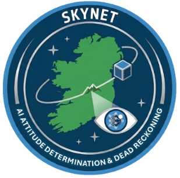

# My SkyNet Github Repo for Tuppersat Project
This repo contains my work from the course of the SkyNet mission. SkyNet was a High Altitude balloon mission developed for the Satellite Subsystems module of the UCD SS&t MSc programme. Our teams focus was on GPS denied navigation, namely using a lightweight CNN for attitude recognition in the event of GPS loss over a known operational region. This was attempted using ARNIE (Attitude Recognition Neural Intelligence Engine), a lightweight CNN built in TensorFlow and converted to TFLite for the Raspberry Pi Zero 2 OBC.

This repo contains only my own work from this project. It does not include the work completed by my teammates Casey Donovan, Liam Moran and Fazira Huwaidaa. The original repo coult not be cloned from UCD for pirvacy reasons.

  

  

SkyNet Mission Parameters:
- Duration of the flight: ~2-hour
- Max Altitude: ~27 km
- Platform: Raspberry Pi Zero

There are has four folders in this REPO:
1. ARNIE 
2. TOM
3. OBS (Onboard Software)
4. Deprecated_Software

-------
Key directory contents: 
1. ARNIE
Data Augmentation:
Data_Set_Creation.py

Training:
ARNIE_GENESIS.py

2. TOM
  - TOM_Exploratory_Work.ipynb

3. OBS
  - MAGNETOMETER

4. Deprecated_Software:
   - Contains versions of OBS software developed during testing that are now no longer in use.
